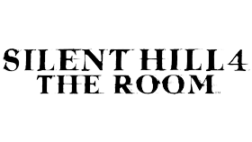

<p align="center">
  <picture>
    <source media="(prefers-color-scheme: dark)" srcset="https://cdn2.steamgriddb.com/logo/dd32544610bf007f0def4abc9b7ff9ef.png">
    
  </picture>
</p>

# Silent Hill 4: The Room for PS Vita

Port of the latest GOG PC version of Silent Hill 4: The Room to the PS Vita.
You may use your own copy of the game.

**[Download the latest release](../../releases/latest)**: the VPK for the PS Vita and the data preparer for Windows, macOS and Linux.

## What you need

- A hacked PS Vita (HENkaku/Enso), at least 4 GB free on `ux0:`
- [Silent Hill 4 from **GOG**, version "1.0 gog v5"](https://www.gog.com/fr/game/silent_hill_4_the_room). Check: `SILENT HILL 4.exe` has SHA-256 `CF7081A6C78DBE51F6DC2E1C9BD978D8486F1D7B59D7A3B88E027C9B39F21DD0`. No other version works (no PS2 files either).
- `ur0:data/libshacccg.suprx` from your own Vita (ShaRKF00D).
- `sh4vita.vpk` and the `sh4prep` download for your computer from the [Releases](../../releases) page

## Install

Download the VPK and the preparer for your computer:

| Download | Platform |
|---|---|
| `sh4vita.vpk` | PS Vita |
| `sh4prep-windows.exe` | Windows |
| `sh4prep-macos-app.zip` | macOS, Apple Silicon (double-click app) |
| `sh4prep-macos` | macOS, Apple Silicon (terminal) |
| `sh4prep-linux-x86_64.AppImage` | Linux x86-64 (double-click) |
| `sh4prep-linux` | Linux x86-64 (terminal) |

### Windows

1. Download and install the supported [**Windows GOG v5** version of Silent Hill 4](https://www.gog.com/fr/game/silent_hill_4_the_room) on your PC, using GOG Galaxy or the offline installer from your GOG library.
2. Run `sh4prep-windows.exe`. Select the game's **installation folder**: the folder containing `SILENT HILL 4.exe` alongside `data/`, `demo/`, `movie/` and `sound/`.
3. Choose a separate output folder and your language, then press **Prepare the files**.
4. When preparation finishes, continue with [Copy to the Vita](#copy-to-the-vita) below.

### Linux and macOS

Use the **Windows GOG v5** game files on these systems too. [InnoExtract](https://github.com/dscharrer/innoextract) can extract supported GOG installers without running them. If you already have the complete installed or extracted game folder, skip to step 4.

1. Download the **offline Windows installer** from your GOG library, including every accompanying `.bin` part. Keep the `.exe` and all its parts together in one folder, with their original filenames.
2. Install InnoExtract. On Ubuntu/Debian:

   ```sh
   sudo apt update
   sudo apt install innoextract
   ```

   On macOS, with [Homebrew](https://brew.sh/) installed:

   ```sh
   brew install innoextract
   ```

   For other Linux distributions, use your package manager or the [InnoExtract installation instructions](https://constexpr.org/innoextract/install).
3. Open a terminal in the folder containing the GOG installer and extract it:

   ```sh
   innoextract --gog --output-dir sh4-extracted "setup_silent_hill_4_the_room_1.0_gog_v5_(80750).exe"
   ```

   The filename may differ, replace it with the name of your downloaded installer. Keep the quotes around the filename, especially if it contains parentheses. Some GOG installers require an additional RAR extractor: if InnoExtract reports one missing, install `unar` or `unrar` through your package manager and retry. See the [InnoExtract manual](https://constexpr.org/innoextract/innoextract.1).
4. Launch the preparer for your system. It is not signed by Apple or by a Linux distribution, so the first launch needs one extra action.

   **macOS (Apple Silicon), double-click:** download `sh4prep-macos-app.zip`, open it, then double-click `sh4prep`. macOS will say it cannot verify the developer: right-click (or Control-click) the app, choose **Open**, then confirm. If macOS still refuses, open **System Settings > Privacy & Security** and click **Open Anyway**.

   **macOS, terminal:**

   ```sh
   chmod +x sh4prep-macos
   xattr -d com.apple.quarantine sh4prep-macos
   ./sh4prep-macos
   ```

   **Linux, double-click:** download `sh4prep-linux-x86_64.AppImage`, allow it to run (right-click > Properties > Permissions > **Allow executing as program**, or `chmod +x sh4prep-linux-x86_64.AppImage`), then double-click it.

   **Linux, terminal:**

   ```sh
   chmod +x sh4prep-linux
   ./sh4prep-linux
   ```

   If the window does not open on Linux, install the display libraries (on Ubuntu/Debian: `sudo apt install libxkbcommon0 libwayland-client0`).

5. In the preparer, select the folder containing `SILENT HILL 4.exe` alongside `data/`, `demo/`, `movie/` and `sound/`. After InnoExtract, this may be `sh4-extracted/app/`; use whichever folder directly contains these files and directories.
6. Choose a separate output folder and your language, then press **Prepare the files**. Continue with [Copy to the Vita](#copy-to-the-vita).

The preparer rejects unsupported game executables (wrong versions or PS2 files).

### Copy to the Vita

1. Install `sh4vita.vpk` with VitaShell.
2. Copy the generated **`sh4` folder** from your chosen output folder to **`ux0:data/`**. USB is much faster than FTP. The result must look like this:

   ```text
   ux0:data/sh4/
     SILENT HILL 4.exe
     data/
     demo/
     movie/
     sound/
     sh4vita.json
   ```

3. Start Silent Hill 4 from the LiveArea.

Saves go in `ux0:data/sh4/save/`. The current log is `ux0:data/sh4/sh4log.txt`; the 19 previous launches are kept as `sh4log.txt.01` through `sh4log.txt.19` (newest first).

### Updating

Close the game and install the new VPK over the existing application with VitaShell. Keep `ux0:data/sh4/`, including your saves and settings. Normal port updates replace the application and its bundled cache, you do not need to prepare the GOG files again unless an update explicitly requires it. If it requires preparing files again, you must backup your `ux0:data/sh4/save/` folder.

## Controls

The button layout is fixed (no remapping). You can review it at any time in-game with **Options → View controls**.

<table>
<tr>
<td valign="top" width="50%">

### Move & camera

| Input | Action |
|:--|:--|
| **Left stick** | Move / side-step |
| **Right stick** | Turn / look around |
| **D-pad** | Select item |
| **L** | Recenter camera |
| **R** | Aim |

</td>
<td valign="top" width="50%">

### Actions

| Input | Action |
|:--|:--|
| **✕ Cross** | Action / examine |
| **○ Circle** | Run / cancel |
| **△ Triangle** | Items |
| **□ Square** | Map / memo |
| **Select** | Album |
| **Start** | Pause |

</td>
</tr>
</table>

### Combos

| Input | Action |
|:--|:--|
| **L + □** | Item info |
| **R + ○** | Dodge |

## Status

The game is playable from start to finish on a real PS Vita.

| Area | State |
|:--|:--|
| Gameplay | Menus, intro, new game, all worlds, save points, sleep/wake |
| Cutscenes and movies | Sound, music and effects work. Movies run at about 30fps |
| Options | 5 languages, camera sensitivity |
| Controls | Fixed layout, see [Controls](#controls) |
| Performance | The game logic runs at 30fps, with interpolated rendering toward 60fps where the Vita can afford it |

Measured intervals and test limits: [validation report](docs/VALIDATION-2026-10-25.md). More numbers: [docs/STATUS.md](docs/STATUS.md).

### Known limitations

- **Heavy scenes** (enemy-heavy subway, water prison, some late-game rooms) are CPU-limited and can drop below 30 fps.
- **First visit to a room** can pause for about a second while it loads.
- **Memory is tight.** In very long sessions (an hour or more) the game can run out of memory. Some textures may then be skipped and look wrong, and in the worst case the game closes. Saving regularly is recommended.
- **Continue** on the title screen stays greyed out. Use **Load** to resume a save.
- The **light glow** effect is disabled for speed.

## Problems

| Message or symptom | Fix |
|:--|:--|
| "GAME FILES NOT FOUND" | The exe and folders must be directly in `ux0:data/sh4/`. |
| "SHADER COMPILER MISSING" | Put `libshacccg.suprx` in `ur0:data/` (install it with [ShaRKF00D](https://github.com/Rinnegatamante/ShaRKF00D)). |
| `sh4prep` rejects the exe | Wrong game version. You need the GOG v5 version of Silent Hill 4. |
| Crash or the game closes | Open an issue and attach the log of the affected session. After a relaunch it is normally `ux0:data/sh4/sh4log.txt.**`. |
| Missing or corrupted textures | Usually a memory shortage after a long session. Restart the game from your last save. If it happens early, open an issue with the log and the room name. |

Logs are in `ux0:data/sh4/`. The current one is `sh4log.txt`, and the 19 previous launches are kept as `sh4log.txt.01` to `sh4log.txt.19`, newest first.

## Build from source

You do not need any of this to play: the [Releases](../../releases) page has the VPK and the preparers. This section is for people who want to rebuild the port or work on it.

No game file is ever in this repository. You need your own copy of the GOG v5 `SILENT HILL 4.exe` (SHA-256 `CF7081A6C78DBE51F6DC2E1C9BD978D8486F1D7B59D7A3B88E027C9B39F21DD0`). The C code generated from it (`port/gen/`, about 68 MB) and the analysis output (`re/out/`) are produced on your machine and are never committed.

### How it works

1. **Ghidra** exports the list of functions of the executable (`re/ghidra/ExportFunctions.java`).
2. **`recomp/x86rec.py`** translates every x86 function into C, using that export.
3. **`port/`** compiles the generated C together with a runtime that replaces Win32, Direct3D 8, DirectInput and DirectSound (D3D8 runs on vitaGL), and links it into an `eboot.bin` for the Vita, packaged as a VPK.
4. **`tools/sh4prep/`** (Rust) is the separate desktop tool that prepares the player's game files.

### Requirements

| Step | Tools |
|:--|:--|
| Recompiler | Python 3 with [Capstone](https://www.capstone-engine.org/) |
| Function export | [Ghidra](https://ghidra-sre.org/) 12 and JDK 21 |
| Vita build | Linux or WSL (Ubuntu), [VitaSDK](https://vitasdk.org) (`VITASDK=~/vitasdk`), CMake |
| Graphics layer | [vitaGL](https://github.com/Rinnegatamante/vitaGL), built from source (see below) |
| Libraries | vitaShaRK, SceShaccCgExt, math-neon, SDL2 for Vita, taiHEN stubs (all from the VitaSDK ecosystem) |
| Preparer | Rust (stable) |

### 1. Put the game exe in place

```sh
mkdir -p game
cp "/path/to/SILENT HILL 4.exe" game/sh4.exe
```

### 2. Export the functions with Ghidra

```sh
analyzeHeadless <project-dir> sh4 -import game/sh4.exe \
  -scriptPath re/ghidra -postScript ExportFunctions.java re/out/functions.json -deleteProject
```

### 3. Generate the C code

```sh
python recomp/x86rec.py
```

This takes about 2 minutes and writes `port/gen/`. Unchanged files are not rewritten, so later runs only recompile what changed.

### 4. Build vitaGL

The port needs vitaGL with depth/stencil preservation between scenes. The build script refuses to link against a vitaGL that lacks it.

```sh
git clone https://github.com/Rinnegatamante/vitaGL ~/src/vitaGL
cd ~/src/vitaGL
make -B NO_DEBUG=1 STORE_DEPTH_STENCIL=1 -j"$(nproc)"
make NO_DEBUG=1 STORE_DEPTH_STENCIL=1 install
```

Use `make -B` whenever you change these flags: make does not track them. The patches in `port/patches/` apply to vitaGL commit `2bdbe895ddc6a7e410a9ea55a8f53d8173c61ad8`, in a separate checkout, and are only needed for the compiled-shader cache and the compressed-texture backend. See [docs/WORKFLOW.md](docs/WORKFLOW.md) for how to use them.

### 5. Build the VPK

```sh
bash port/build.sh -DSH4_TRACE_CALLS=OFF -DSH4_GUEST_MB=200
```

The result is `build/sh4.vpk` (the build itself runs in `~/build/sh4vita`, because compiling on a Windows drive from WSL is slow). Always pass `-DSH4_GUEST_MB=200`: it sets the guest memory size, and the default is wrong for the Vita.

### 6. Build the preparer

```sh
cd tools/sh4prep
cargo test --release
cargo build --release
```

On Linux, the GUI needs `libgtk-3-dev libxkbcommon-dev libwayland-dev`. Prebuilt binaries for Windows, macOS and Linux are produced by the GitHub Actions workflow `sh4prep`.

### Testing

- A Windows build of the runtime exists for functional tests (`port/Makefile.pc`). It cannot measure Vita performance.
- Recompiler checks: `recomp/difftest.py` and `recomp/difftest_x87.py`.
- Runtime checks: the scripts in `port/test/`.
- Build options, environment variables, console tooling and the full developer workflow: [docs/WORKFLOW.md](docs/WORKFLOW.md). Game internals: [docs/GAME.md](docs/GAME.md). Current project state: [docs/HANDOFF.md](docs/HANDOFF.md) and [docs/STATUS.md](docs/STATUS.md).

### Layout

| Folder | Content |
|:--|:--|
| `recomp/` | x86 to C recompiler and its tests |
| `port/src/` | Runtime: Win32, D3D8, DirectX replacements, Vita layer |
| `port/patches/` | Patches for vitaGL |
| `port/livearea/` | LiveArea artwork |
| `tools/sh4prep/` | Desktop preparer (Rust) |
| `re/` | Reverse-engineering notes and Ghidra scripts |
| `docs/` | Documentation |

## License

The original code in this repository (the recompiler, the runtime, the Vita layer and the `sh4prep` preparer) is released under the **GNU General Public License v3.0**. See [LICENSE](LICENSE).

Third-party components keep their own licenses. Their texts are in [LICENSES/](LICENSES/) and the list is in [THIRD_PARTY_NOTICES.md](THIRD_PARTY_NOTICES.md). The GPL covers this project's code only. It does not cover Silent Hill 4, and it does not cover artwork that comes with its own terms (see Credits).

## Legal

**Silent Hill 4: The Room** belongs to Konami. This project is not affiliated with, endorsed by or sponsored by Konami, GOG or Sony.

- No game file is included in this repository, in the VPK or in the preparer. The port only works with your own legitimate copy of the **GOG v5** version of the game, which `sh4prep` checks by hash before preparing anything.
- The C code generated from the game executable is created on your own machine and is never distributed.
- Do not ask for game files, ROMs, dumps or pirated copies in issues or discussions. They will be removed.
- You need a Vita with custom firmware. Install and use this port at your own risk.

## Credits

**Project**
- Port, recompiler, runtime and tools: [vallfrr](https://github.com/vallfrr).
- Testing and feedback: the testers who played the game and sent their logfiles.
- AI tools assisted the reverse engineering and the coding (Claude and Codex). Design decisions and all validation on real hardware were done by hand.

**Vita ecosystem**
- [VitaSDK](https://vitasdk.org) and vita-headers.
- [vitaGL](https://github.com/Rinnegatamante/vitaGL), vitaShaRK, SceShaccCgExt and math-neon, by Rinnegatamante and contributors.
- [ShaRKF00D](https://github.com/Rinnegatamante/ShaRKF00D), which installs the shader compiler module the game needs.
- [taiHEN](https://github.com/yifanlu/taiHEN) and [HENkaku](https://henkaku.xyz).
- [VitaShell](https://github.com/TheOfficialFloW/VitaShell), which the install steps rely on.

**Libraries**
- [SDL2](https://www.libsdl.org) (zlib license).
- [pl_mpeg](https://github.com/phoboslab/pl_mpeg) by Dominic Szablewski (MIT), with an added MPEG audio Layer I decoder.
- [TLSF](https://github.com/mattconte/tlsf) by Matthew Conte (BSD 3-clause).

**Reverse engineering tools**
- [Ghidra](https://ghidra-sre.org) 
- [Capstone](https://www.capstone-engine.org).

**Artwork**
- Controller screen: Vita outline by Tokyoship (Wikimedia Commons, CC BY 3.0), recolored; button prompts from [Kenney Input Prompts](https://kenney.nl/assets/input-prompts) (CC0).
