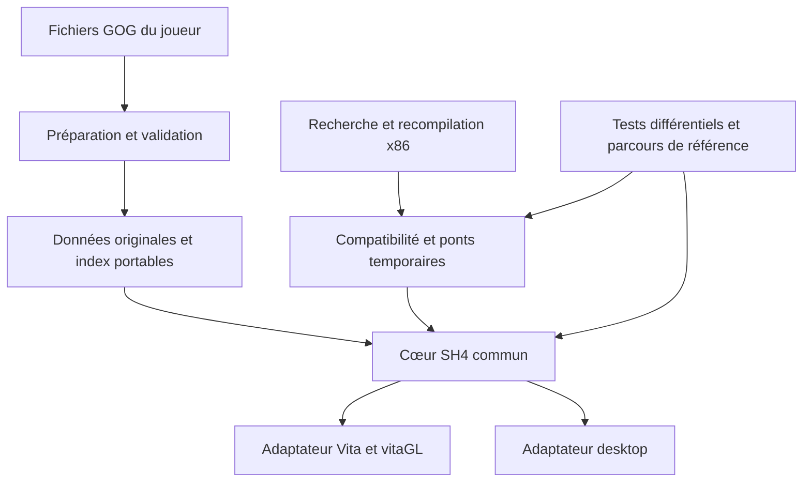

# SH4 au-delà de la Vita : étude et proposition

Étude du 28 octobre 2026 pour Valentin, à partir des dépôts publics et des sources locales de `sh4vita`. Ce document propose une direction ; il ne constate ni une reconstruction complète du jeu, ni de nouvelles plateformes prises en charge.

**Recommandation : faire évoluer le port Vita en une base SH4 portable, documentée et testable, avec des modules natifs progressivement reconstruits.** La Vita reste le premier produit jouable et le banc de contrainte mémoire. Un cœur commun peut ensuite servir à d'autres ports et outils. Attendre une décompilation intégrale avant de partager les composants utiles n'est pas nécessaire.

Il existe déjà des travaux publics sur SH4, notamment deux dépôts Switch. La place à construire est celle d'un projet fiable et utile aux autres développeurs. L'antériorité d'un dépôt ne garantit ni son adoption ni une exclusivité sur le jeu.

## 1. Ce qui a été vérifié

Les README, arbres de fichiers, métadonnées GitHub et plusieurs fichiers de build ont été consultés. Dix dépôts centraux ont été relevés avec leur commit ; d'autres outils SH4 ont été vérifiés sur leurs pages publiques. Des recherches Web et GitHub ont complété l'inventaire. Les métadonnées et notes brutes sont conservées hors Git dans `build/research/sh4-foundation-20261028/`.

Aucun port externe n'a été installé, exécuté ou mesuré. « Le projet annonce » et « le build prévoit » ne signifient donc pas « testé par nous ». Une recherche publique ne permet pas d'exclure un travail privé, peu indexé ou publié plus tard. Je n'ai pas identifié de décompilation humaine complète de SH4 GOG, compilable et vérifiée, dans les sources consultées ; ce constat n'est pas une preuve d'inexistence.

| Travail existant | Faits utiles vérifiés | Conséquence pour notre projet |
|---|---|---|
| [SH1, décompilation de référence](https://github.com/shdecompilations/silent-hill-decomp) | Recherche du code PS1 recompilable à l'identique. Le projet distingue explicitement cet objectif de la réalisation d'un port. | Une décompilation de référence peut constituer un produit autonome, séparé des améliorations et adaptations. |
| [SH1, port de SlickAmogus](https://github.com/SlickAmogus/silent-hill-decomp) | Le port s'appuie sur le C reconstruit du jeu, avec un dossier `pc_port` et PsyCross comme sous-module. | Le code du jeu et les services nécessaires pour le faire tourner peuvent évoluer séparément. Ce n'est pas notre même point de départ technique. |
| [PsyCross, fork SH1](https://github.com/SlickAmogus/PsyCross) | Fork d'OpenDriver2/PsyCross : réimplémentation des API Psy-Q, du GTE et des services graphiques/audio PS1 sur des API modernes. | Le principe d'une couche de plateforme est pertinent. Son implémentation PS1 ne remplace pas la couche Direct3D 8/Win32 de SH4 PC. |
| [SH4 Switch, 72ak](https://github.com/72ak/sh4-nx) | Recompilation statique x86 vers C, fondée sur le runtime de `cutarev/sh3-nx`. Le README annonce Switch et un parcours Linux jusqu'à l'appartement ; il indique que les FMV sont ignorées dans cette version. | Le portage de SH4 hors Windows existe déjà. Sa documentation ne démontre pas à elle seule une validation complète du jeu. |
| [SH4 Switch, cutarev](https://github.com/cutarev/sh4-nx) | Autre dépôt SH4 annoncé en développement : x86 vers C, SDL2/OpenGL, vidéos via FFmpeg. CMake distingue desktop et Switch. | Notre ambition multiplateforme doit tenir compte de ces travaux, plutôt que se présenter comme la première. Leur état réel reste à mesurer. |
| [Sparagas/Silent-Hill](https://github.com/Sparagas/Silent-Hill) | Documentation de formats, scripts et exports de symboles de débogage, notamment pour SH4 E3 Trial PS2. | Des informations de types et de noms peuvent accélérer l'identification du moteur. La correspondance avec le GOG PC doit être démontrée. |
| [sh4bin](https://github.com/HunterStanton/sh4bin), [sh4pac](https://github.com/HunterStanton/sh4pac) | Outils spécialisés dans les archives `.bin` et audio `.pac`. | Étudier leurs formats et cas particuliers avant de développer un nouvel extracteur généraliste. |
| [sh4worldmeshimport](https://github.com/HunterStanton/sh4worldmeshimport), [SH4_bone_mesh_bin_PC](https://github.com/alanm20/SH4_bone_mesh_bin_PC) | Importeur Blender de géométrie du monde et lecteur Noesis de modèles avec squelette. | Points de comparaison pour les outils d'inspection des ressources ; pas des remplacements démontrés du moteur. |
| [SilentHill4Fix](https://github.com/HunterStanton/SilentHill4Fix) | Projet de correctifs pour la version PC. | Il existe aussi un travail de maintenance du jeu original à inventorier. Un correctif PC ne s'applique pas automatiquement au runtime Vita. |
| [Devilution et DevilutionX](https://github.com/diasurgical/DevilutionX) | La [base de recherche](https://github.com/diasurgical/devilution) distingue sa conservation du code original des fonctionnalités et du support multiplateforme de DevilutionX. | Exemple particulièrement utile pour séparer référence, moteur jouable et améliorations, tout en utilisant les données du joueur. |
| [OpenGOAL](https://github.com/open-goal/jak-project) | Ensemble comprenant décompilateur, compilateur, sources GOAL reconstruites, outils d'extraction et runtime. | Une infrastructure cohérente peut porter plusieurs jeux. Son langage et son historique sont spécifiques aux Jak ; ce n'est pas une recette à transposer intégralement. |
| [N64Recomp](https://github.com/N64Recomp/N64Recomp) et [Zelda64Recomp](https://github.com/Zelda64Recomp/Zelda64Recomp) | Outil de recompilation distinct du projet de jeu et du moteur de rendu RT64. | On peut publier une base utile avant une décompilation humaine complète, et isoler outil, adaptation du jeu et backend. |

Les limites et termes d'utilisation doivent se lire dans chaque projet. La présence de sources publiques ne constitue pas une autorisation générale de copier tous leurs fichiers dans le nôtre.

## 2. Ce que nous avons réellement aujourd'hui

Le port produit déjà du code machine pour la Vita. Il conserve toutefois une organisation héritée du binaire PC : état `CPU`, espace mémoire invité, adresses du GOG, contrats Win32/DirectX et adaptateurs de fonctions. « Recompiler pour ARM » et « reconstruire un moteur organisé autour de types natifs » décrivent deux degrés différents de transformation.

| Élément local | Valeur réutilisable | Travail nécessaire |
|---|---|---|
| `recomp/x86rec.py`, `re/ghidra/`, `port/src/rt/x86rt.h` | Chaîne permettant d'exécuter le GOG pris en charge, et référence fonctionnelle pendant les réécritures. | Séparer la traduction x86 des règles et remplacements propres à SH4 ; documenter les limites du jeu d'instructions et les conventions. |
| `port/src/win32/`, `port/src/dx/`, `port/src/d3d8/` | Services de compatibilité déjà utilisés par un jeu réel. | Clarifier les dépendances, états globaux, propriétaires de ressources et exigences du backend. Ne pas annoncer une compatibilité Win32 ou D3D8 universelle. |
| `model_uv`, `collision_native`, `collision_segment`, `audio_adpcm`, `sound_archive` | Plusieurs interfaces travaillent déjà sur des vues de données et paramètres explicites, avec des tests séparés du jeu. | Distinguer leurs noyaux des ponts `CPU` ; documenter les formats, durées de vie et refus. La chaîne complète du jeu n'est pas reconstruite. |
| `tools/sh4prep` et `docs/PREPARED-DATA.md` | Préparation par le propriétaire du GOG, séparation application/données/sauvegardes, schémas et caches identifiés. | Définir ce qui peut être commun à plusieurs plateformes et ce qui reste dérivé pour une cible GPU particulière. |
| Tests différentiels, parcours PC, audits de pièces et cinématiques | Moyen de vérifier un remplacement contre le comportement existant. | Rendre les bancs compréhensibles, exécutables sans chemins personnels et accompagnés de leurs limites. |
| `src/vita/main.c`, `src/pc/main.c`, `plat.h` | Première frontière de plateforme déjà présente. | Le CMake actuel sélectionne VitaSDK par défaut ; le Makefile PC cible MinGW/Windows et `opengl32`. Un build Linux de notre runtime reste à établir. |

Les préparateurs Linux et macOS ne constituent pas des ports Linux et macOS du jeu. À ce stade, notre exécution de référence desktop est celle de Windows, à côté de la Vita. Le frontend desktop utilise notamment un contexte OpenGL 2.1 de compatibilité : annoncer un port macOS ARM ne se résume pas à produire un autre exécutable.

La référence testeur du 28 octobre possède une archive des sources effectives dans `build/room-audit/baseline-20261028/`. Des changements de cette référence existent encore dans l'arbre de travail : le seul nom du dernier commit ne décrit pas toute la version testée. Avant d'ouvrir largement les contributions, un jalon doit relier sans ambiguïté sources, options, dépendances et paquet.

Notre avantage potentiel tient à l'ensemble **jeu jouable + connaissances vérifiées + bancs de comparaison + modules réutilisables**. Le nombre de lignes et les 68 Mo de C généré ne mesurent pas cette maturité. Nous ne disposons pas d'un pourcentage fiable de reconstruction humaine de l'ensemble du jeu.

## 3. Positionnement recommandé

Le projet pourrait se présenter comme **une reconstruction portable progressive de SH4 GOG, dont la Vita est le premier port**. Le nom de travail « SH4 Portable » sert ici à décrire ce périmètre ; sa disponibilité et son choix public ne sont pas validés.

Il aurait trois livrables qui se renforcent :

1. **Une base de recherche SH4** : correspondances d'adresses, types reconstruits, formats, contrats et corpus de validation, avec niveaux de confiance et version du GOG.
2. **Un moteur commun progressivement natif** : chargeurs, ressources, animation, collision, audio et rendu, conservant le chemin recompilé tant que ses consommateurs sont nécessaires.
3. **Des applications par plateforme** : Vita en priorité, puis un desktop réellement reproductible. D'autres mainteneurs pourraient fournir des adaptateurs et paquets sans dupliquer toute la logique.

Ces livrables ne nécessitent pas trois dépôts immédiatement. Commencer dans le dépôt existant évite de multiplier les versions incompatibles et préserve les liens des utilisateurs. Un composant mérite un dépôt autonome lorsqu'un deuxième consommateur en prouve l'utilité et que ses interfaces sont suffisamment stables.

Pour construire une reconnaissance durable, rendre visibles le créateur et le mainteneur du port, publier des résultats reproductibles, faciliter les contributions et garder un point de référence à jour. Un développeur doit pouvoir reprendre un module et retrouver son origine, ses tests et les personnes qui le maintiennent. Une base ouverte autorise aussi des forks selon sa licence ; l'adoption ne peut pas être imposée par le nom du projet.

Les crédits des bibliothèques, des recherches et des contributions externes doivent rester exacts. Le rôle de Valentin dans le port Vita et dans cette évolution peut être explicite sans s'attribuer les travaux antérieurs sur le jeu.

## 4. Architecture cible proposée

Le schéma suivant est une **cible de migration**, pas une description de composants tous terminés.



Une organisation possible, à mettre en place par petites extractions :

```text
recomp/                 traduction x86 et descriptions de fonctions
re/                     connaissances vérifiées et provenance
src/sh4/                logique et formats propres au GOG supporté
src/core/               modules natifs utilisables indépendamment
src/compat/             CPU invité, Win32, DirectX et ponts transitoires
src/platform/vita/      mémoire, affichage, contrôles et packaging Vita
src/platform/desktop/   services desktop et frontend
tools/sh4prep/          préparation des données du joueur
tests/                  tests autonomes et parcours nécessitant le GOG
docs/                   installation, développement et recherche
```

Le premier résultat doit être un module compilable et testé indépendamment, pas un déplacement massif de fichiers. Pendant la transition, les adaptateurs gardent les adresses et conventions du GOG. Le cœur expose des vues bornées, identifiants de ressources, générations, propriétaires et fonctions explicites. Il ne doit pas dépendre du remplissage d'une pile x86 pour effectuer ses opérations internes.

La couche D3D8 reste disponible pour les appels non migrés. Un autre backend GPU n'a pas à reproduire les objets Vita ni à consommer ses programmes compilés. Les différences de capacité graphique se traitent à une frontière définie, avec mesure et comparaison des effets. Ajouter Vulkan, Metal ou un moteur généraliste n'est pas un prérequis à cette séparation.

Le temps logique reste explicite et distinct du temps d'affichage. Une interpolation vers 60 images affichées ne doit pas accélérer les événements, l'IA, les sons ou la progression. Une compilation sur une nouvelle architecture impose aussi de vérifier arrondis, alignements, conventions de threads et données little-endian ; ce n'est pas une garantie de comportement identique.

## 5. Données préparées, mises à jour et sauvegardes

La compatibilité de données doit séparer quatre domaines :

| Domaine | Contrat proposé |
|---|---|
| Originaux du GOG | Version et empreinte prises en charge explicitement. Les fichiers restent fournis par le joueur. |
| Index et données dérivées portables | Schéma versionné, offsets et tailles vérifiés, entiers de taille définie ; aucun pointeur hôte ou objet GPU sérialisé. |
| Caches propres à une plateforme | Versionnés par backend et invalidables indépendamment des données et sauvegardes ; un cache GPU Vita ne devient pas un cache desktop. |
| Sauvegardes et préférences | Préservées lors des mises à jour. Compatibilité avec le format existant vérifiée, migrations explicites et copies de secours si elles deviennent nécessaires. |

Cela permet de viser une préparation initiale commune et des mises à jour ordinaires de la seule application. Ce n'est pas une promesse que le préparateur n'évoluera jamais. Une optimisation optionnelle peut rester un fichier dérivé régénérable ou disposer d'un repli sur les originaux. L'absence d'un index facultatif ne doit pas être confondue avec la perte d'un fichier de jeu indispensable.

À plus long terme, ce socle peut servir à un inspecteur de scènes, un visualiseur de modèles/cinématiques et des outils de modification. Commencer par l'inspection en lecture seule, puis des substitutions de ressources contrôlées, est plus raisonnable que promettre immédiatement un éditeur complet ou la compatibilité avec tous les mods PC. Les mods qui injectent du code x86 dans le jeu Windows ne sont pas directement des plugins du runtime ARM.

Le lecteur audio de 512 Kio reste un **essai à confirmer sur Vita par Valentin**. La réserve originale de 22,61 Mio est encore présente. Ni ce rapport ni cette architecture ne valident son retrait, la suppression des pauses de lecture ou la résolution des crashs longue durée. Voir [l'audit audio](NATIVE-SOUND-ARCHIVE.md).

## 6. Conditions nécessaires pour que d'autres développeurs utilisent le travail

**Licence et provenance.** Aucun fichier de licence générale n'a été trouvé à la racine du dépôt local. `tools/sh4prep/Cargo.toml` déclare MIT, et des composants tiers disposent de leurs propres notices ; cela ne suffit pas à définir les droits de réutilisation de tout le projet. GitHub explique qu'un dépôt public sans licence ne donne pas les mêmes permissions qu'un projet explicitement open source : [documentation GitHub](https://docs.github.com/en/repositories/managing-your-repositorys-settings-and-features/customizing-your-repository/licensing-a-repository).

Avant de choisir une licence, inventorier ce qui est écrit pour le port, adapté d'un autre projet, fourni par une dépendance ou dérivé du jeu. Le choix ne peut pas changer les droits d'un tiers ou ceux du jeu. Le [document de provenance du port SH1](https://github.com/SlickAmogus/silent-hill-decomp/blob/pc-port/COPYRIGHT.md) illustre pourquoi une licence affichée à la racine ne décrit pas nécessairement tous les fichiers. Aucune licence n'a été ajoutée ou modifiée pendant cette étude.

Pour les composants dont Valentin peut effectivement choisir les termes, une licence permissive facilite l'intégration dans d'autres outils ; une licence copyleft privilégie le partage des modifications distribuées selon ses conditions. Ce choix mérite une décision explicite après l'inventaire. Le code original du jeu, le C automatiquement généré et les ressources du joueur ne deviennent pas notre propriété parce que nous les transformons.

**Build reproductible.** Une personne disposant du GOG pris en charge doit pouvoir obtenir le même runtime sans les répertoires `J:`, les caches personnels ou une bibliothèque Vita modifiée silencieusement. Documenter les versions de toolchain et les patchs, la génération locale, les options et les empreintes. Les données et le code généré du jeu restent hors Git.

**Tests accessibles.** Exécuter les tests des modules et formats sur des données synthétiques dans la CI publique. Les comparaisons nécessitant le GOG s'exécutent localement avec la copie du contributeur ; ne pas fournir ces fichiers dans les artefacts publics. Distinguer les résultats exacts sur données et calculs, les comparaisons d'images d'un même backend et les tolérances justifiées entre GPU différents.

**Contributions abordables.** Préparer un guide indiquant comment compiler un module, reproduire un défaut, comprendre un pont et soumettre une modification. Les petites tâches doivent avoir une entrée, un résultat attendu et un test, par exemple documenter un format ou éliminer un chemin personnel. Le traitement d'une animation entière demande un lot séparé et un contrat explicite.

**Suivi lisible.** Chaque anomalie et résultat doit indiquer le build, la plateforme, les données, le parcours et ses limites. Une capture correcte ne démontre pas l'absence de fuite mémoire. Un test de 386 cas n'est pas un parcours narratif exhaustif. Un port compilé n'est pas une plateforme qualifiée.

## 7. Ordre de travail et critères de passage

Les priorités de stabilité et de performance Vita restent ouvertes. Cette étude n'autorise pas à les déclarer terminées au profit d'une refonte générale.

| Lot | Travail | Critère concret avant de poursuivre |
|---|---|---|
| 0 — Référence | Rattacher le paquet testeur à ses sources effectives, options, dépendances et limites connues. | Un autre développeur peut identifier exactement ce qui est distribué ; les défauts connus ne sont pas masqués. |
| 1 — Réutilisation | Inventaire de provenance, proposition de licence, guide développeur et carte des modules. | Les conditions et les frontières du travail réutilisable sont explicites. Aucun changement de licence externe implicite. |
| 2 — Premier noyau autonome | Extraire logiquement un module déjà testé, par exemple ADPCM, sans changer son comportement en jeu. | Compilation et tests sans VitaSDK, OpenGL ou état `CPU` dans le noyau ; pont existant conservé. |
| 3 — Build commun | Définir des cibles communes et deux adaptateurs, sans réécrire immédiatement tout le rendu. | Windows et Vita recompilent les mêmes modules ; régressions fonctionnelles vérifiées. |
| 4 — Première nouvelle plateforme | Établir notre build Linux desktop et un parcours réel, puis qualifier l'installation et les contrôles. | Une tierce personne peut préparer ses données, lancer le jeu et fournir un rapport reproductible. macOS reste un lot distinct. |
| 5 — Reconstruction utile | Migrer une chaîne complète avec données, propriétaire et libération : ressources/modèles/audio selon les profils et défauts reproduits. | Équivalence vérifiée et bénéfice mesuré, ou amélioration démontrée de maintenabilité. Les deux critères ne se confondent pas. |
| 6 — Outils de communauté | Inspecteur, catalogue de scènes/cinématiques et interfaces de substitutions. | Utilité démontrée pour un contributeur externe, sans exposer les structures internes instables comme API publique permanente. |
| 7 — Extensions | Autres plateformes et éventuellement composants partagés avec d'autres jeux. | Un mainteneur et un besoin réel justifient chaque cible ; aucune compatibilité automatique SH2/SH3 promise. |

Le premier lot technique après la stabilisation ne serait donc pas « tout réécrire dans un autre langage ». Il serait de rendre une petite partie existante autonome et réutilisable, avec le même comportement, puis d'établir un vrai second backend hôte. Les grosses réécritures restent possibles, avec des contrats et des preuves plus solides.

Une décompilation visant une recompilation binaire identique peut rester un axe de recherche séparé si des contributeurs souhaitent la mener. Elle peut produire des noms et contrats très utiles. Ce n'est pas un jalon obligatoire avant chaque amélioration du port, ni un pourcentage à calculer à partir du nombre de fonctions automatiquement traduites.

## 8. Ce qui ferait perdre du temps ou de la crédibilité

- Annoncer la première base SH4 multiplateforme alors que des ports Switch/Linux sont publics.
- Renommer du C généré « source entièrement décompilée » ou annoncer une reconstruction terminée sans critères correspondants.
- Généraliser un nouveau framework x86/DirectX pour tous les jeux avant qu'un deuxième jeu le justifie.
- Ouvrir cinq dépôts, un SDK et plusieurs plateformes sans personnes pour les maintenir.
- Garder toutes les anciennes allocations en ajoutant des représentations natives, puis annoncer un gain mémoire théorique comme obtenu.
- Promettre 30/60 fps sur la base d'une architecture ou des performances d'une autre machine.
- Copier du code, des modèles ou des données de débogage tiers sans avoir établi leur provenance et leurs conditions.
- Ajouter un système de mods qui rendrait les sauvegardes et les mises à jour imprévisibles avant de qualifier le jeu de base.

## 9. Proposition de présentation publique, à relire

> An experimental PS Vita port of the GOG PC version of Silent Hill 4: The Room, evolving toward a documented, portable codebase for future ports and tools. The project combines static recompilation with progressively reconstructed native systems and requires your own supported copy of the game.

Cette formulation décrit une trajectoire, sans annoncer une décompilation complète, une exclusivité ou des ports desktop déjà livrés. Le nom de Valentin et le rôle de mainteneur peuvent être affichés clairement sur le dépôt et les pages du projet ; les origines et contributions restent créditées séparément.

## 10. Repères de sources

Les commits suivants identifient l'état des dépôts centraux relevé pendant l'étude. Leurs branches peuvent évoluer après le 28 octobre. Les observations sur les fichiers de build Switch et SH1 se rapportent à ces versions.

| Dépôt | Commit relevé |
|---|---|
| [SlickAmogus/silent-hill-decomp](https://github.com/SlickAmogus/silent-hill-decomp/tree/0b312869597ad53d8099076e5273595434adc20f) | `0b312869597ad53d8099076e5273595434adc20f` |
| [SlickAmogus/PsyCross](https://github.com/SlickAmogus/PsyCross/tree/947cbfebf0240925d6529e5997e53244c99c19d7) | `947cbfebf0240925d6529e5997e53244c99c19d7` |
| [shdecompilations/silent-hill-decomp](https://github.com/shdecompilations/silent-hill-decomp/tree/dced55429e7e2ddc07c068060a29d9486870a991) | `dced55429e7e2ddc07c068060a29d9486870a991` |
| [72ak/sh4-nx](https://github.com/72ak/sh4-nx/tree/f58c3f9e64612ab193920c1d12c85305ef231d9e) | `f58c3f9e64612ab193920c1d12c85305ef231d9e` |
| [cutarev/sh4-nx](https://github.com/cutarev/sh4-nx/tree/77070797916ea8bac68aeee1df124ffdcd71c369) | `77070797916ea8bac68aeee1df124ffdcd71c369` |
| [Sparagas/Silent-Hill](https://github.com/Sparagas/Silent-Hill/tree/f08ec73e32c0b0d5ddbb58f96eef51f0b8ee5b35) | `f08ec73e32c0b0d5ddbb58f96eef51f0b8ee5b35` |
| [OpenGOAL](https://github.com/open-goal/jak-project/tree/94684e32f60008d3d9617621e7c3a478c9e2af56) | `94684e32f60008d3d9617621e7c3a478c9e2af56` |
| [Zelda64Recomp](https://github.com/Zelda64Recomp/Zelda64Recomp/tree/b65c482ed672258eb684ab94a4e8c8aa662615ee) | `b65c482ed672258eb684ab94a4e8c8aa662615ee` |
| [N64Recomp](https://github.com/N64Recomp/N64Recomp/tree/ffb39cdad1da5de07eaaa48bd1db4a89a7986771) | `ffb39cdad1da5de07eaaa48bd1db4a89a7986771` |
| [REA](https://github.com/morluto/rea/tree/9593bc536b0549f0997e6b7922904f8fd1e91021) | `9593bc536b0549f0997e6b7922904f8fd1e91021` |

REA est un outil possible d'analyse et d'exploration ; il ne fournit pas en lui-même un moteur SH4 ou une preuve d'équivalence. Ghidra, les bancs différentiels et les mesures existantes restent utilisables indépendamment. Aucun nouvel outil n'a été installé pendant cette étude.

Le reste de l'inventaire renvoie aux dépôts primaires dans les tableaux. Les comparaisons d'architecture, l'ordre des lots et le positionnement sont des recommandations déduites de ces sources et de notre code, pas des engagements formulés par leurs auteurs.

**État après étude :** statut audio marqué à confirmer ; document enregistré localement ; aucune modification du runtime, du préparateur, du paquet testeur ou de la console pour cette recherche. Aucun nouveau dépôt, licence ou partenariat créé, aucune publication ni prise de contact externe.
